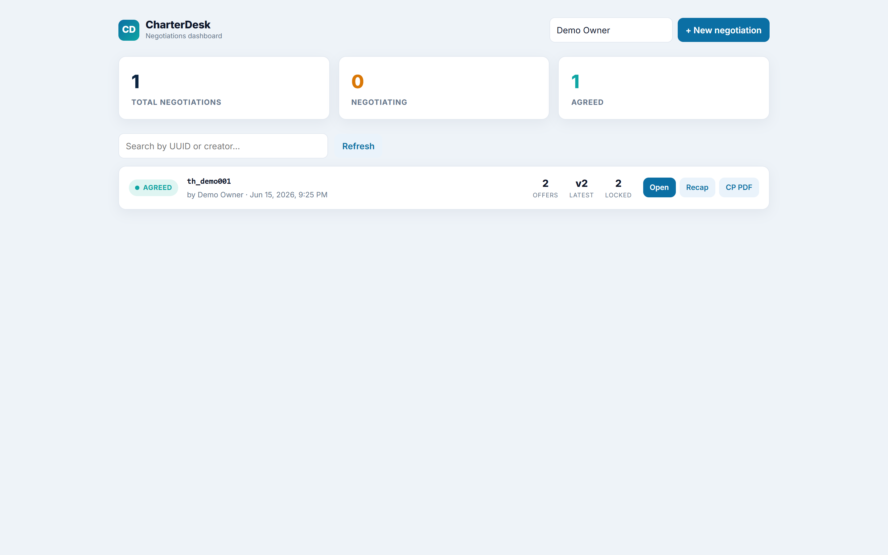
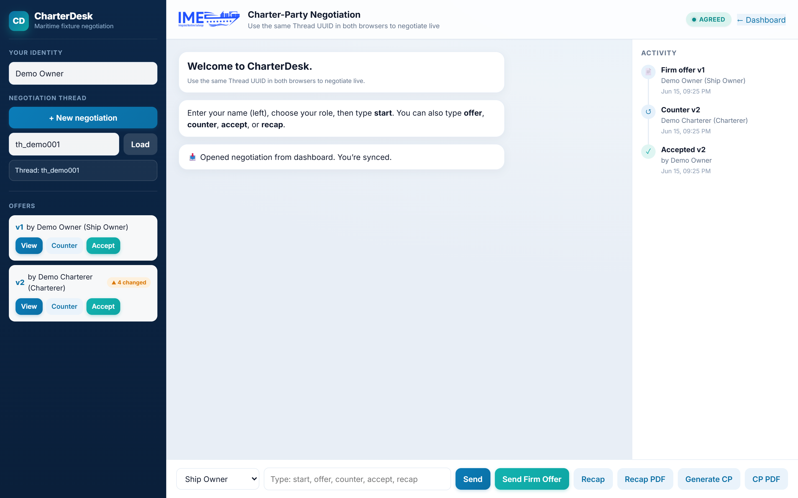
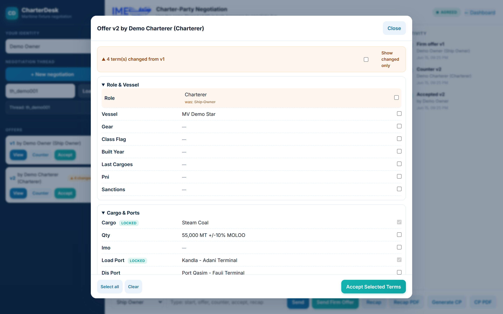
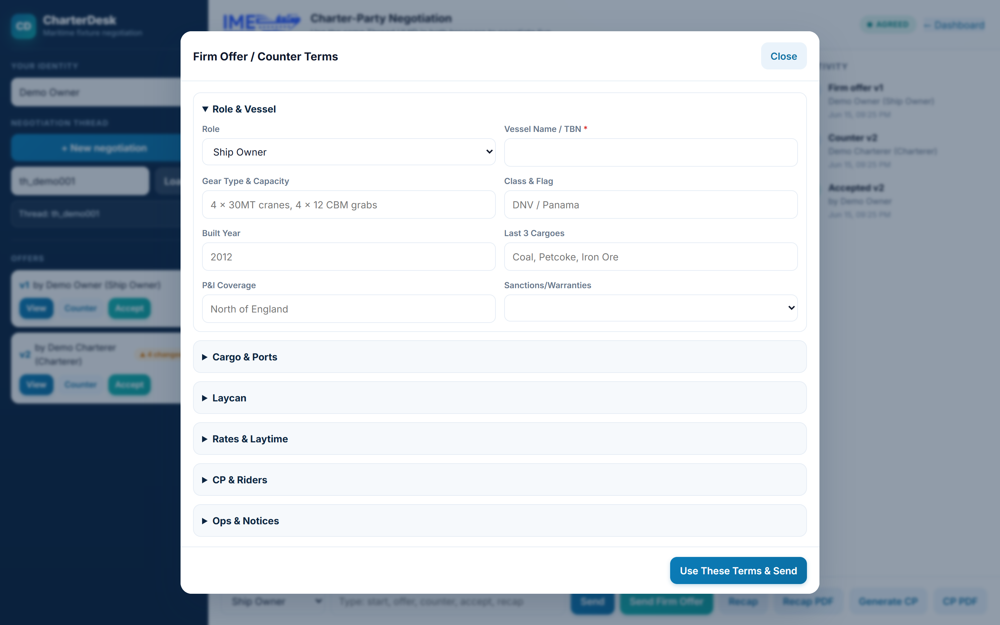
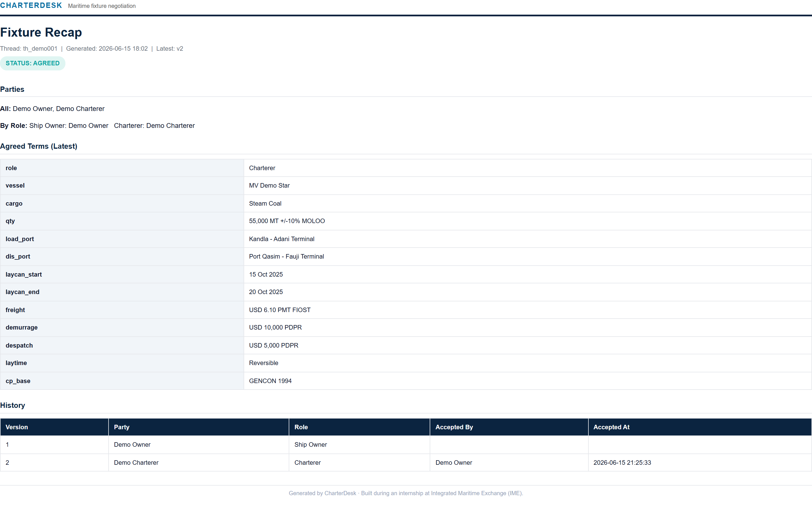

# CharterDesk  
_A structured charter-party (CP) negotiation and document-generation tool for maritime fixture deals._

> Built during an internship at **Integrated Maritime Exchange (IME)**.

[](https://github.com/KanishkSigar/CharterDesk/actions/workflows/ci.yml)
[](#7-running-the-application)
[](#14-switching-between-html-and-pdf-recap)
[](#14-switching-between-html-and-pdf-recap)

---

## 1. Overview

CharterDesk is a PHP + MySQL application (runs on XAMPP) for structured, guided voyage
fixture negotiations between **Ship Owners**, **Charterers**, **Buyers**, and **Sellers**.
Two parties negotiate the ~38 terms of a shipping fixture in versioned offers, lock the
terms they agree on, and export a finished **Charter Party** or **recap** as HTML or PDF.

**Key Features**
- Negotiations **dashboard** with status (Open / Negotiating / Agreed), per-thread stats and search
- Private, two-party negotiation with one-use invitations and live polling
- Firm Offer -> Counter -> Accept workflow with **versioned offers**
- Collapsible ~38-term fixture form (vessel, cargo, laycan, freight, demurrage, laytime, NOR, arbitration, CP form, ...) with **required-field validation**
- **Version diff**: changed terms are highlighted and show their previous value, with a "show changed only" toggle
- **Activity timeline** of every offer, counter and acceptance, plus a live status badge
- Locked-field system: accepted terms carry forward and are protected in counters
- Branded **Charter Party** and **fixture recap** generation as HTML or PDF (dompdf)

**AI Assist (Claude):** an in-app assistant that **explains** unfamiliar CP terms, **drafts**
riders/clauses from a plain-English prompt, and **reviews** the latest offer to flag unusual or
risky terms. Backed by [`assist.php`](assist.php) calling the Claude Messages API
(`claude-opus-4-8`). Set an `ANTHROPIC_API_KEY` before starting PHP to enable it:

```bash
# Windows (PowerShell)
$env:ANTHROPIC_API_KEY = "sk-ant-..."
C:\xampp\php\php.exe -S 127.0.0.1:8000 -t .

# macOS / Linux
ANTHROPIC_API_KEY=sk-ant-... php -S 127.0.0.1:8000 -t .
```

The key is read from the environment only - it is never committed. Without it, the rest of the
app works normally and the Assist panel shows a friendly "key not set" message.

---

## Screenshots

**Negotiations dashboard** - status tiles, per-thread stats, search:



**Negotiation workspace** - offers, activity timeline, live status badge:



**Version diff** - changed terms highlighted with their previous value, plus locked-term badges:



**Firm-offer / counter form** - grouped sections with required-field validation:



**Generated fixture recap** (HTML / PDF via dompdf):



---

## Private pilot

Run `docker compose up --build` and open <http://localhost:8090/dashboard.html>.

1. Enter your name and create a negotiation.
2. Open **Invite counterparty** in the workspace and send the link privately. It can be
   redeemed once within 24 hours. Generating another link replaces an unused link.
3. The other participant opens the link in a separate browser or private window, enters
   their name, and joins. Each dashboard lists that browser's negotiations.
4. Exchange an offer and a counter. The recipient of the latest offer can accept it;
   both participants can then export the agreed recap.

Access follows a browser session cookie. Keep the session volume between deploys.
This is an invitation-based pilot with no email accounts or self-service recovery.
Use HTTPS for a hosted pilot and set `CHARTERDESK_SECURE_COOKIE=1` on the app if a reverse
proxy terminates TLS. Keep the invitation URL on the same hostname as the dashboard.

### Existing Docker databases and sample data

Apply the participant table before starting the updated app on an existing database:
```bash
docker compose exec -T db mariadb -u charterdesk -pcharterdesk-local ime_negotiation < sql/participants.sql
```
For a non-Docker install, apply the same SQL to the existing database with your normal
database migration credentials. Existing offers and recaps are preserved and require
authorized access. To grant the first host access to a legacy negotiation, run
`php claim_legacy_thread.php THREAD_UUID` on the server. With Docker, try
`docker compose exec web php claim_legacy_thread.php th_demo001` for the seeded sample.
Open the printed relative invitation path from the application's base URL and enter the
original creator's name. The old single-form session endpoints are retired.

## 2. Requirements

| Tool | Purpose | Command |
|------|----------|----------|
| XAMPP | PHP 8 +, Apache, MySQL | `php -v` |
| Git | Version control | `git --version` |
| Composer | PHP package manager | `composer -V` |

---

## 3. Project Structure

Place under your webroot:

```
C:\xampp\htdocs\ime-negotiation
```

```
dashboard.html        Negotiations dashboard (landing page)
index.html            Negotiation workspace (offers, timeline, composer)
assets/
  css/app.css         Design system + all component styles
  js/app.js           Workspace logic
  js/dashboard.js     Dashboard logic
dashboard_data.php    Aggregated overview feed (read-only)
create_thread.php     New negotiation
get_thread.php        Fetch thread + offers
save_offer.php        Save offer / counter (handles locked fields)
lock_fields.php       Lock agreed fields
accept_offer.php      Record acceptance
generate_cp.php       Charter Party (HTML / PDF)
generate_recap.php    Fixture recap (HTML / PDF)
db.php / db_connect.php  DB connection (PDO + mysqli)
questions.json        Fixture term definitions
sql/
  schema.sql          Database schema (run once)
  participants.sql    Participant and invitation schema
  seed.sql            Optional demo data
scripts/              Dev utilities (schema migration / inspection)
composer.json         PHP dependencies (dompdf)
readme.md             This file
```

---

## 4. Database Setup

Install the negotiation schema and the participant table in this order:

```bash
# from the project root
mysql -u root < sql/schema.sql
mysql -u root ime_negotiation < sql/participants.sql

# optional: load demo data (one negotiation with an accepted counter)
mysql -u root < sql/seed.sql
```

For phpMyAdmin, import `sql/schema.sql`, select the `ime_negotiation` database, then import
`sql/participants.sql`. Import `sql/seed.sql` once if you want the sample negotiation.

---

## 5. Database Connection

Connection settings for the app live in **`db.php`** and are read from environment
variables, with XAMPP-friendly defaults for local development:

| Variable | Default | Purpose |
|----------|---------|---------|
| `DB_HOST` | `127.0.0.1` | MySQL host |
| `DB_PORT` | `3306` | MySQL port |
| `DB_USER` | `root` | MySQL user |
| `DB_PASS` | _(empty)_ | MySQL password (XAMPP default is empty) |
| `DB_NAME` | `ime_negotiation` | Database name |

For local XAMPP you can leave the defaults as-is. For any deployment, set the
`DB_*` variables in your environment instead of hardcoding credentials.

Backend files include the connection with:
```php
require 'db_connect.php';   // exposes $conn (mysqli)
```

---

## 6. Install Dependencies

Dependencies are managed by Composer and are **not** committed to the repo, so
install them after cloning:

```bash
cd C:\xampp\htdocs\ime-negotiation
composer install
```
This installs everything pinned in `composer.lock` (including `dompdf/dompdf`).
If you see `missing zip extension`, enable `extension=zip` in `php.ini`.

---

## 7. Running the Application

1. Start **Apache** and **MySQL** in XAMPP.  
2. Open the dashboard (recommended entry point):  
   ```
   http://localhost/ime-negotiation/dashboard.html
   ```
   From there, create or open a negotiation - it deep-links into the workspace
   (`index.html?uuid=...`). You can also open `index.html` directly.

---

## 8. Basic Usage

### Start / Join
- Create a negotiation from the dashboard, or open a private invitation in your browser.
- Choose your role when drafting an offer.

### Create Offer
- Type `offer` or click **Send Firm Offer**
- Fill the 40-question collapsible form  
- Submit to generate v1 offer

### Counter / Accept
- Counterparty views and counters existing offers
- Accepted terms auto-lock; only unresolved ones reappear

### Recap
- Once agreed, click **Recap**
- Opens fixture recap (HTML or PDF)

---

## 9. Chat Commands

```
start          → show quick help
offer          → open form
counter        → counter last offer
accept         → accept latest offer
recap          → open recap
```

---

## 10. Git Workflow

```bash
git add -A
git commit -m "update UI, locking, recap"
git push
```
First-time setup:
```bash
git branch -M main
git remote add origin https://github.com/KanishkSigar/IME-AI-Chat-.git
git push -u origin main
```

---

## 11. Hosted pilot

Use a stable HTTPS URL and scope network access to your pilot participants. Apply
`sql/participants.sql` before deploying to an existing database. Share the invitation link
from the workspace. The thread ID identifies the negotiation, and access requires a
participant session.

---

## 12. Troubleshooting

| Issue | Cause | Fix |
|-------|--------|-----|
| JSON parse error | PHP emitted HTML error | Check DevTools → Network |
| View/Counter not working | Invalid JSON | Ensure `header('Content-Type: application/json')` |
| Negotiation unavailable | This browser has no session for it | Open the original browser session or a valid invitation |
| PDF blank | Dompdf not installed | `composer require dompdf/dompdf` |

---

## 13. Switching Between HTML and PDF Recap

### HTML Recap (default)
Frontend link:
```
generate_recap.php?uuid=<thread_uuid>
```
Opens a printable web recap.

### PDF Recap
1. Confirm Dompdf installed  
2. Change link to:
   ```
   generate_recap.php?uuid=<thread_uuid>&pdf=1
   ```
Downloads `fixture_recap_<uuid>.pdf` directly.  
Switch freely between the two modes—no rebuild required.

---

## 14. Production Recommendations

- Run behind HTTPS with production database credentials and persistent session storage.
- Add rate limits and audit logging before a broader rollout.

---
Developed by **IME Negotiation Automation Team**  
© 2025 IME Platform / TBI-GEU Innovation Lab
